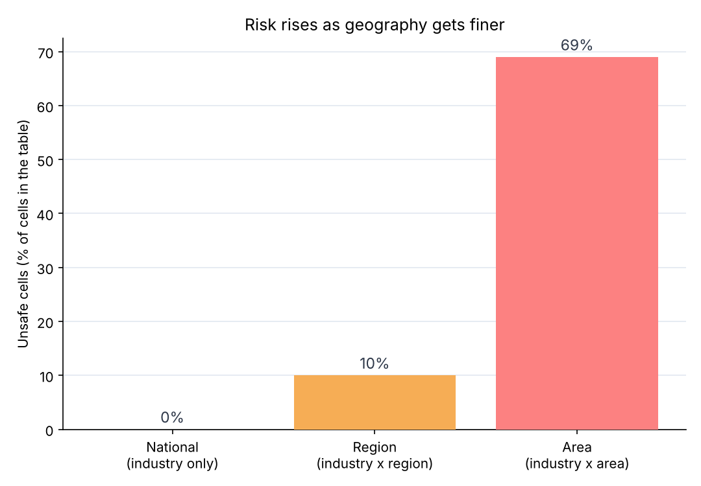
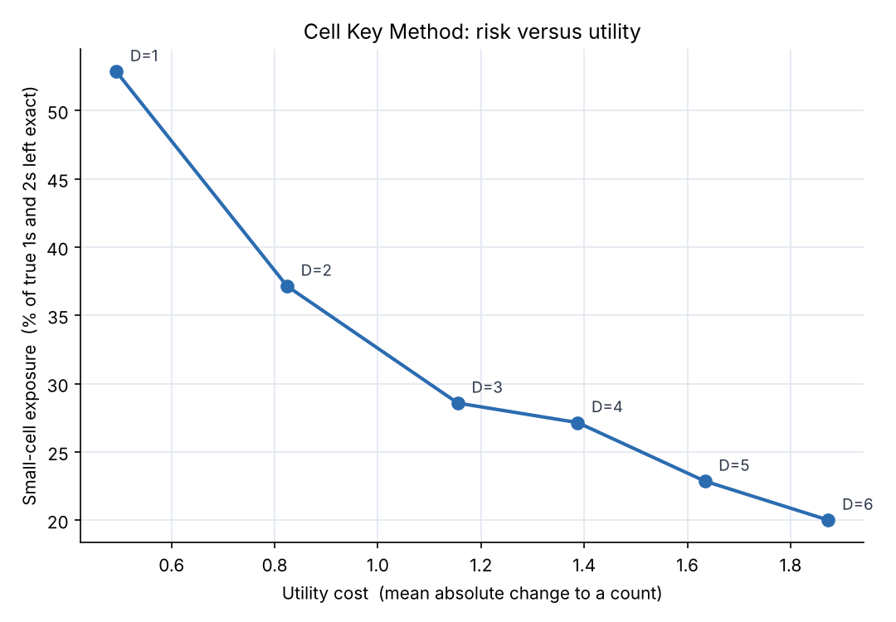
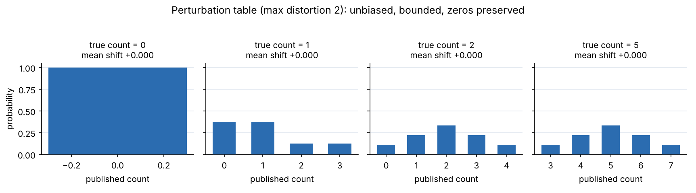

# CellGuard

A small, readable toolkit for **statistical disclosure control (SDC)**: the step
that protects people and businesses before a statistical table is published.

When a national statistics agency or a product like a flexible table builder
publishes totals, it has to make sure nobody can read a single person's or a
single business's private value back out of those totals. CellGuard shows how
that is done, from end to end, in code you can read in an afternoon:

1. build **flexible magnitude tables** from business microdata,
2. measure **disclosure risk** with the standard rules,
3. protect counts with the **Cell Key Method**,
4. protect magnitude tables with **cell suppression**,
5. measure the **utility cost** of the protection,
6. trade risk against utility and draw the **confidentiality map**.

Everything runs on synthetic data generated from a seed. No real business or
personal data is used anywhere.

> This is a teaching model, not a production system. It implements the real
> ideas in a simplified, honest form so they can be understood and defended.
> Where it simplifies a real method, it says so.

---

## Why this is hard

A "flexible" table is one the user defines on demand: pick the variables to
cross and the quantity to total. The same businesses then appear in many
different tables. Two problems follow:

- A cell built from one or two businesses, or dominated by one big business,
  leaks that business's value. If one firm is 95% of an industry total, anyone
  who knows the total nearly knows that firm's turnover.
- Because the same businesses appear in many tables, protection has to be
  **consistent**. If you just added fresh random noise every time, an attacker
  could ask for the same cell again and again and average the noise away, or
  subtract two almost-identical tables to recover a hidden cell.

CellGuard deals with both.

---

## The pieces

### 1. Microdata and tables

`cellguard/microdata.py` generates businesses with a turnover (drawn from a
heavy-tailed lognormal, so some cells are dominated) and classification
variables: region, area within the region, and industry. `cellguard/tabulate.py`
builds a magnitude table over any choice of those variables, keeping each
cell's individual contributions sorted largest first, because the risk rules
need the biggest contributors, not just the total.

### 2. Disclosure risk

`cellguard/risk.py` flags a cell as unsafe if any of three standard rules fire:

- **Minimum contributors.** Fewer than three businesses in a cell: each one can
  subtract its own value from the total to learn the others.
- **(n, k) dominance rule.** The largest `n` businesses are more than `k` of the
  total. Default (2, 0.90).
- **p% rule.** The second largest contributor can estimate the largest to within
  `p` percent. Formally the cell is unsafe when `total - c1 - c2 < (p/100) * c1`.

### 3. The Cell Key Method (protecting counts)

`cellguard/ckm.py` is the part closest to real practice, and it is the method a
flexible table builder uses to protect frequency counts.

- Every record gets a fixed **record key**, a random number in `[0, 1)`.
- A cell's **cell key** is the fractional part of the sum of its contributors'
  record keys. It depends only on which records are in the cell, so the same
  cell always has the same cell key in every table.
- A **perturbation table** says, for each true count, how much noise to add as a
  function of the cell key.

Because the cell key is fixed to the records, the noise is fixed to the cell.
Ask for the same cell in a hundred tables and you get the same answer every
time, so averaging and differencing attacks do not work. The perturbation table
is built to be **unbiased** (it does not push counts up or down on average),
**bounded** (no count moves by more than the maximum distortion), and safe at
the edges (a true zero always stays zero, and counts never go negative).

The perturbation table here is an honestly simplified version of a real one. A
production table is built by constrained optimisation to hit an exact variance
and maximum distortion; ours is a truncated triangular distribution balanced to
zero mean. The properties that matter are kept and are checked by the tests.

### 4. Cell suppression (protecting magnitudes)

A dominated magnitude cell leaks information no matter how you jitter the
published number, so magnitude tables are usually protected by suppression.
`cellguard/protect.py` does **primary** suppression (hide the unsafe cells) then
**secondary** suppression (hide a few more so that every row and column with any
suppression has at least two suppressed cells). With only one hole in a line, an
attacker recovers it by subtracting the other cells from the line total; a
second hole closes that.

### 5. Utility

`cellguard/utility.py` measures the cost. For the Cell Key Method it is the mean
absolute change to a count and the signed bias. For suppression it is the share
of cells hidden and the share of the grand total they held.

---

## Results

Run on the default synthetic data (400 businesses, seed 1).

### Risk rises as geography gets finer (the spatial strand)

The same businesses, tabulated by industry at three geographic levels:

| Level | Table | Cells | Unsafe cells |
|-------|-------|------:|-------------:|
| National | industry | 8 | 0.0% |
| Region | industry x region | 40 | 10.0% |
| Area | industry x area | 142 | 69.0% |

Splitting the country into smaller pieces spreads the same firms across more
cells, so each cell has fewer contributors and more are dominated. This is why a
flexible table builder has to assess risk per query, not once.



### The Cell Key Method trades risk for utility

Higher maximum distortion protects small cells better but changes counts more.
"Small-cell exposure" is the share of genuinely small cells (true count 1 or 2)
left at their exact true value.

| Max distortion | Utility cost (mean abs change) | Small-cell exposure |
|---------------:|-------------------------------:|--------------------:|
| 1 | 0.49 | 52.9% |
| 2 | 0.82 | 37.1% |
| 3 | 1.16 | 28.6% |
| 4 | 1.39 | 27.1% |
| 5 | 1.63 | 22.9% |
| 6 | 1.87 | 20.0% |



The perturbation itself is unbiased and bounded, and a true zero always stays
zero:



At maximum distortion 2 the method changes 63% of cells, never by more than 2,
with an average bias of about -0.06 (close to zero), and the consistency check
confirms the same cell gets the same perturbed count whichever way the table is
built (0 mismatches out of 142 cells).

### Suppression hides a little to protect a lot

On the industry by region table, 4 cells are unsafe. Primary suppression hides
those 4, and secondary suppression adds 2 more, so 6 of 40 cells are hidden
(15%), covering 4.7% of the grand total. No row or column is left with a single
hole.

---

## Running it

```bash
pip install -r requirements.txt

make test        # run the unit tests
make all         # generate data, run every demo, draw every chart
```

Or run the pieces directly:

```bash
python scripts/generate_microdata.py          # synthetic microdata -> data/
python scripts/run_risk.py                     # risk assessment
python scripts/run_ckm.py                      # Cell Key Method + consistency check
python scripts/run_suppress.py                 # cell suppression + published table
python scripts/make_ru_plot.py                 # risk-utility map
python scripts/make_spatial.py                 # spatial strand chart
python scripts/make_ptable_plot.py             # perturbation table chart
```

Every script takes `--seed` and `--n`, so you can see how the picture changes
with more or fewer businesses.

---

## Layout

```
cellguard/
  microdata.py    synthetic business microdata (seeded)
  tabulate.py     flexible magnitude tables
  risk.py         p% rule, (n,k) dominance rule, minimum contributors
  ckm.py          the Cell Key Method and its perturbation table
  protect.py      cell suppression (primary + secondary), key-driven perturbation
  utility.py      information-loss metrics
  rng.py          one seeded random stream
scripts/          run the demos and draw the charts
tests/            unit tests (run with: python -m pytest -q)
```

---

## What is simplified, and what is faithful

Faithful: record keys and cell keys, the consistency property, the p% and
dominance rules, primary and secondary suppression, and the risk-utility
trade-off.

Simplified: the perturbation table is built from a truncated triangular
distribution rather than by the constrained optimisation a real agency uses, and
the magnitude perturbation in `protect.py` is a demonstration of the mechanism,
not a safe stand-alone method for dominated cells. These simplifications are
called out in the code so the model stays honest about what it is.

## Licence

MIT. See [LICENSE](LICENSE).
